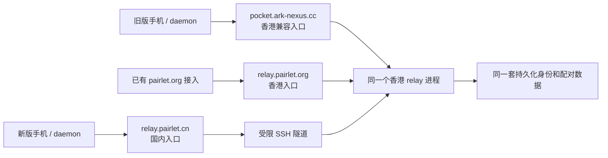

# 2.6.1 发布、中国区恢复与域名过渡方案

核查日期：2026-10-27。状态：2.6.1 发版前准备；ASC 已保存准确 App 备案号，中国大陆已回读为 `Available`，用户随后确认 App Store 已恢复可见。异常删除已按授权恢复，发布门禁已修复。尚未远程合并 main、正式发布新版本或切换生产入口。具体构建与验收状态见 [2.6.1 发布准备清单](RELEASE-2.6.1.md)。

当前顺序：**中国区已恢复 → 完成 2.6.1 验收与发布 → 启用新域名并逐步迁移客户端**。商店恢复不等于新域公网或申报过渡范围已验收；后续域名安排仍需按获批详情与实际连接核对。

## 1. 已核实的现状

| 对象 | 本次核查结果 | 对计划的影响 |
| --- | --- | --- |
| 主分支 | GitHub main 为 `5ab34090`；本地 `codex/icp-cn-domain-migration` 位于同一提交 | 本地没有领先 main 的已提交功能改动 |
| PR #412 | `69c30c99`；Codex 用量与重置卡、手机请求 daemon 更新；三项 CI 成功，可合并 | 候选版本已设为 2.6.1；联合验证与门禁修复已完成，正式交付待验收 |
| PR #413 | `31989d1b`；DSH provider/model、指定模型不可用时拒发、回复末尾复制；三项 CI 成功，可合并 | 与 #412 的联合测试已完成；最终集成 head 继续由 CI 核对 |
| 本地删除 | 初始发现 158 个已跟踪文件缺失；已确认来自 10 月 22 日全机 Claude 残留清理 | 用户授权后仅恢复本项目这 158 个文件；逐文件与备份、Git 内容一致，阻塞已关闭 |
| 本地新增 | 国内 Caddy 正式候选、内部 Caddy、SSH 隧道服务、迁移说明，以及 docs 索引调整 | 是入口部署资料，不包含客户端切域实现；适合独立提交 |
| GitHub / 镜像 | 最新正式版均为 2.6.0；镜像 `latest.json.version=2.6.0` | 10 月 18 日记录中“镜像尚未同步”已过时 |
| 公开 App Store | 最初中国区查询为 0；ASC 修复后用户确认“现在可以了” | 中国区公开可见已由用户确认；本轮未独立执行真机下载安装 |
| 香港入口 | 旧域及 `relay.pairlet.org` 的 `/healthz` 均为 200；relay 服务 active | 存量入口应继续保留 |
| 国内入口 | Caddy 与隧道 active；只监听 `127.0.0.1:18080` 和 `:19000`；内部 `/healthz=ok` | 内部链路仍在，公网尚未开放；不能切正式客户端 |
| 新域名 | 本机访问 `https://relay.pairlet.cn/healthz` TLS 失败；香港主机未解析出 A 地址 | 没有取得公网可用证据；应从权威 DNS、TLS 开始验收 |
| 备案 | 用户提供 10 月 27 日工信部通过通知及阿里云 App 列表截图：`粤ICP备2026165853号-2A`，名称 `Pairlet`，后台域名 `relay.pairlet.cn` | 已明确 App 号、名称和登记域名；截图未展示网站备案号、各平台详情或旧版本过渡答复 |
| ASC 中国区 | 最初为 `ICP Filing Number Missing`；保存准确 App 号后回读为 `Available`，用户随后确认前台恢复 | 后台和用户前台反馈闭环；18:35 的 lookup 为 0 仅是传播过程中的历史快照 |
| ASC App 信息 | 2.6.0 为 `Ready for Distribution`，build 71；简体中文名称为 `Pairlet`；已保存 `粤ICP备2026165853号-2A`，原页面和独立页面均显示该值及 `Edit` | 服务端持久化已确认，本次恢复后台可用性未上传新包 |
| 阿里云后台 | 自动化打开的备案订单仍跳转登录页；用户另行提供已备案 App 列表截图 | App 号、名称和域名已有截图证据，其余详情不推定 |

PR：[412](https://github.com/heypandax/pairlet/pull/412)、[413](https://github.com/heypandax/pairlet/pull/413)。公开查询：[中国区](https://itunes.apple.com/lookup?id=6778773969&country=cn)、[美区](https://itunes.apple.com/lookup?id=6778773969&country=us)。查询结果是日期快照，后续执行前需回读。

## 2. 合并与发布前的实际问题

### 已关闭的 P0：158 个文件缺失

初始缺失内容包括 `daemon/.../claude/` 整个后端、`ClaudeTranscriptRefiner.kt`、`protocol/.../ClaudeQuota.kt`、移动端额度逻辑、测试及设计资料。其他代码仍依赖这些实现，因此不能将该批删除提交为发布改动。

处理结果：先保护现场，再核对删除来源和备份。删除来自 10 月 22 日“检查 Claude Code 残留信息”会话的全机清理，包含了文件名或路径含 `claude` 的项目文件，不是本次 PR 的产品改动。备份中 158 份内容与 Git 逐一相同；用户明确授权“仅恢复这 158 个项目文件”后已全部恢复，没有恢复账号、缓存或其他项目。原始会话、文件清单和校验回执保留在本地忽略目录，不进入 Git。

发布准备继续使用隔离 worktree，以免影响原工作区其他内容。

### 已关闭的 P1：候选版本与 Homebrew 发行版本冲突

对两个 PR 的联合源码执行：

```text
bash scripts/check-release-version.sh 2.6.1
Release version check failed: homebrew-template is 2.6.0 but mobile is 2.6.1
```

原因：#412 保留了有效的 2.6.0 Homebrew 安装地址和 hash，但版本脚本要求模板也与候选客户端锁步。`release-preview.yml`、`release.yml`、`ios-release.yml` 和 `ios-submit-existing.yml` 均调用该检查，直接发布会在前置检查停住。

修复已实现：核心平台源码版本继续严格锁步；Homebrew cask 与新增 `packaging/homebrew/release.json` 的已发行版本、双架构 hash 和 URL 必须一致，允许它暂时落后于候选版。已用 GitHub 2.6.0 正式 `SHA256SUMS` 核对当前两份 hash。正式资产齐备后，`scripts/homebrew-release.py prepare/verify` 对包的实际字节和校验清单严格核对，生成新 cask 和发行记录。发布工作流新增候选 artifact，不自动推 tap。13 项新回归测试通过，源码错版、单改 cask、缺包、篡改包与同版改 hash 均会拒绝。

### 联合检查结果与边界

- 两个 PR 的精确 head 经 `git merge-tree` 和隔离 worktree 合并，均无文本冲突；合并树为 `3ebe657401b49e8e9057257fd70a2291cc5584c4`。
- 联合源码的商店文本检查、仓库内容检查、暂存差异格式检查已通过。
- 联合执行 `bash scripts/check-all.sh --no-daemon`，共 6,083 项：首次 6,061 通过、1 失败、21 条件跳过。唯一失败是 `TempDirsTest.the_default_roots_cover_this_machines_java_tmpdir`：测试把 home 定位在 worktree 的 `daemon/build/test-home`，本次 worktree 位于 `/tmp`，与“home 不在系统临时目录”的断言冲突。
- 保留首次完整结果后，将隔离 worktree 移至非系统临时目录，执行 `./gradlew :daemon:test --tests dev.ccpocket.daemon.disk.TempDirsTest --no-daemon`，该类 3 项全部通过。源码、测试和断言未修改，`git write-tree` 仍为上述合并树。该环境相关失败已定向复验；没有把首次失败改记为单次全量全绿。
- 模块数量：observability 30、observability-sentry 19、protocol 445、relay 125、mobile desktop 2,631、daemon 2,833；21 项条件跳过均来自 daemon。随后 Android Debug 构建与 iOS Simulator Arm64 Kotlin 编译通过；未操作真实第三方账号。
- 现有两份 PR 的 CI 不能替代最终 main 的 CI，也不能替代 iPhone 实机、真实 DSH 插件、正式签名安装与 daemon 远程升级验收。
- #412 的重置卡不应为测试随意消耗真实额度；先用模拟结果覆盖丢回执、同一幂等键重试和切换电脑。正式远程升级用受支持的隔离托管安装验证，不能启动第二个本机 daemon。

## 3. 2.6.1 的合并、提交与交付顺序

| 顺序 | 操作 | 完成条件 |
| --- | --- | --- |
| 1 | 保护现场，确认并处理异常删除；固定两个 PR 的 head | 待提交文件逐项明确，无未确认删除 |
| 2 | 以 main 建集成分支，合入 #412 和 #413 | 再次核对 head 未变化；共同修改处已审查 |
| 3 | 独立提交国内入口配置和事实说明 | 不夹带运行回执、IP、凭据或原始账号材料；更新“备案通过”的证据边界 |
| 4 | 发布准备提交：版本门禁、2.6.1 中英说明、构建号与必要修正 | 公共发行说明包含两个 PR；iOS 文案只写 iPhone/iPad 相关变化 |
| 5 | 全量测试、主 CI、版本/品牌/素材检查；针对新行为真机验收 | 所有阻塞关闭，记录精确 SHA；首启同意、免配对 Demo、推送/重连可用 |
| 6 | 合并 main，固定 `v2.6.1`，按现有发布工作流构建 | daemon、桌面、Android、iOS 同源；Harmony 仍按现有 opt-in 规则 |
| 7 | 包校验、发布及渠道同步 | 最终 hash、macOS 签名公证、Android 原签名升级、Homebrew/Scoop、旧镜像下载均核对 |
| 8 | iOS 审核与结果回读 | 明确区分上传 VALID、提交审核、审核通过、实际可下载；更新发布记录 |

发版默认先保持现有连接入口，以降低功能升级与网络迁移同时出问题的排障成本。新域名切换建议独立为后续 2.6.2；如果中国区恢复依赖该切换，则将其作为中国区重新开放的前置条件，不能只修改商店链接应付。

发版回退以撤回有问题的渠道入口、修复并发布更高版本为主；已经分发的包不能视为已召回。出现故障时先暂停进一步分发并保留旧服务，不能通过重写 `v2.6.1` 或替换已发布同名包造成 hash 漂移。

## 4. 中国区恢复：备案号已补齐，ASC 已可用

2026-10-27 登录 ASC 后，已取得两处相互印证的证据：

- [地区可用性](https://appstoreconnect.apple.com/apps/6778773969/distribution/pricing/availability)：`China mainland` 显示 `ICP Filing Number Missing`；`View` 展开说明为 `You must provide an ICP Filing Number.`。
- [App 信息](https://appstoreconnect.apple.com/apps/6778773969/distribution/info)：首次回读 `China Mainland ICP Filing Number` 尚未设置，`Set Up` 弹窗中的号码字段为空。已配置简体中文本地化，名称为 `Pairlet`，副标题为 `AI 编程伴侣`。

这确认了当前中国区不可用的直接阻塞；不再将历史 5.0 拒审猜测为本次原因。缺失项修正后仍应回读状态，不能预先保证没有后续校验项。

**网站域名备案通过，不自动等于 App 备案通过，也不会自动替你修复 ASC。** 阿里云将网站备案与 App 备案作为并列事项；App 备案登记的是实际连接后台的域名。[阿里云 App 备案说明](https://help.aliyun.com/zh/icp-filing/basic-icp-service/support/basics-about-icp-filling-for-apps)

用户随后提供工信部短信，确认主体备案 `粤ICP备2026165853号` 于 2026-10-27 通过；阿里云 App 列表截图进一步确认本 App 号为 **`粤ICP备2026165853号-2A`**，名称 **`Pairlet`**，登记后台域名 **`relay.pairlet.cn`**。主体号不能替代具体 App 号。Apple 要求 ICP 信息与工信部登记一致，并核对简体中文元数据；本 App 的简体中文名称已与截图匹配。未配置简体中文时才核对主要语言。[Apple App 信息说明](https://developer.apple.com/help/app-store-connect/reference/app-information/app-information)

执行记录：在 ICP 设置弹窗填写 `粤ICP备2026165853号-2A` 并点击 `Save`；加载耗时较长，未重复提交。随后独立打开 App 信息页，已显示准确号码及 `Edit`；原页面也关闭弹窗并显示该号码，确认已持久化。地区页首次回读仍为 `ICP Filing Number Missing`，再次刷新后中国大陆变为 **`Available`**。没有改动销售范围或代发审核消息，也没有上传新包。

恢复边界：2026-10-27 18:35（UTC+8）ASC 已可用，公开中国区 lookup 仍返回 `resultCount=0`；尚未用中国区账号完成真机下载/更新，不能把后台可用等同于所有用户已能下载。公开分发还需传播；若超过 24 小时仍不可见，再检查状态并联系 Apple，不反复删填号码或切换地区。

18:41（UTC+8）用户反馈 App Store 仍搜不到，复核结果：ASC 中国大陆仍为 `Available`；Apple 中国区 lookup 与 `Pairlet` 软件搜索都返回 0；中国区直达页面显示“无法找到你所需的页面。”；美区 lookup 仍可查到 2.6.0。因此当时的结论是**备案号已保存、后台地区可用性已恢复，但中国区公开商店尚未恢复可见**，不能只解释成搜索排序问题，也不能将传播延迟当作已证实的唯一原因。

随后用户在同一会话确认“现在可以了，继续做发版新版前的准备吧”。据此将中国区公开可见记为用户已确认恢复；没有将这句话扩展为已完成真机下载、安装、旧版升级或新域名验证。

具体执行顺序：

1. App 备案号、名称和后台域名已通过用户截图核对；各平台详情、网站备案和旧版本过渡口径仍以获批详情为准。
2. 已在 `App Information → App Store Regulations & Permits → China Mainland ICP Filing Number → Set Up` 保存号码，并通过独立页面回读确认。
3. 已回读中国大陆为 `Available`，无需再调整销售范围。
4. 本次准确号码与现有简体中文名称匹配，2.6.0 已恢复后台地区可用性；如后续登记域名或 Apple 通知要求新包，再满足对应条件。新域公网验收与客户端过渡仍按第 5—7 节推进。
5. 以 ASC 状态、公开中国区目录和中国区账号真机下载/更新共同验收，不把“保存成功”当作“已恢复上架”。

| ASC 实际状态 | 处理方式 |
| --- | --- |
| `ICP Filing Number Missing` | 填写本 App 的有效备案信息，保存并确认验证通过 |
| `ICP Filing Number Invalid` | 按工信部登记核对备案号和名称等元数据，修正不一致项；不能填官网备案号代替 |
| `Not Available` / 中国大陆未选择 | 原因解决后恢复该地区销售范围，再回读状态 |
| `Cannot Sell App` / Apple 移除 | 读取原因与最新审核通知；按通知补资料并申请恢复，不能仅靠勾选地区 |
| `Processing to Available` | 跟踪转为可用；超过 24 小时仍未完成时联系 Apple |

这些状态含义来自 [Apple 状态表](https://developer.apple.com/help/app-store-connect/reference/app-information/app-and-submission-statuses)。销售范围变更可能需要最多 24 小时对全部用户可见，但这不是 Apple 必须在 24 小时内批准恢复的承诺。[Apple 销售范围说明](https://developer.apple.com/help/app-store-connect/manage-your-apps-availability/manage-availability-for-your-app-on-the-app-store)

另外，仓库已记录 1.9.5 因中国区 OpenAI/ChatGPT 关联表述触发 5.0，且发生过隐私披露和年龄分级问题。这是**历史个案，不是本次下架原因的证明**。本次需按最新审核意见核查实际功能、全部本地化、截图、隐私接收方和年龄问卷，不能靠删词隐瞒实际服务。[项目拒审记录](../../APP-STORE-REJECTIONS.md)

本轮已修复备案字段并回读中国区 `Available`。若 Apple 后续要求新二进制、实际后台域名一致或功能调整，再绑定满足条件的新版本。旧安装能联网也需另验。

如后续需要人工恢复，说明可围绕“App ID、获批 App 备案号、登记名称、已修正字段、当前实际后台域名和请求恢复中国区”起草。备案号与域名必须用核实值；目前仅操作 ICP 字段，未代发审核消息或另交人工恢复申请。

## 5. 推荐域名架构：新旧入口，共用一个 relay



这是现有内部链路的延伸：国内 Caddy → SSH 隧道 → 香港 `127.0.0.1:9000`。不复制数据库，不再起一套独立 relay。当前 `Broker.kt` 把在线路由保存在进程内；即使两套 relay 共用数据库，手机和 daemon 分别连到不同进程也不保证互通。

这种方案是**迁移访问入口**，香港仍参与传输处理。若目标变成把 relay 和数据真正搬到内地，应按第 8 节另做一次核心迁移，不能对外把入口迁移说成数据已全部在内地。

### 哪些可以跳转，哪些需要保留原 URL

| 流量 | 推荐过渡 | 原因 |
| --- | --- | --- |
| `/v1/daemon`、`/v1/device` WebSocket | 新旧域直接反代同一进程，不返回 301/302/308 | 旧客户端是否跟随升级重定向没有兼容保证；代理负责 WS Upgrade |
| `/v1/pair/*` 等 API | 保持原路径和请求方法，反代 | 配对、鉴权不应依赖跨域重定向行为 |
| `/dl/latest.json`、版本包、安装脚本 | 长期保留旧入口；新镜像完全验收后再启用 | 旧更新器写死旧镜像地址；保住更新路径才能迁出老版本 |
| `/support-api/*` | 保留 API 反代，单独核验来源白名单/验证组件 | 不能当作普通网页跳走 |
| 官网、手册、普通帮助页 | 新站内容完整后先用临时跳转验证，再选择性改 301/308；保留路径和查询参数 | 适用于浏览器页面；隐私、手册深链接逐项验收 |

Caddy 原生支持 WebSocket 反代，配置重载默认可能关闭现有 WS；应选择低峰窗口并验证重连。任何缓解选项都先针对已部署 Caddy 2.6.2 验证支持情况。[Caddy 反代说明](https://caddyserver.com/docs/caddyfile/directives/reverse_proxy)

**不要简单把旧域 CNAME 到新域或将旧域直接解析到国内 ECS。** CNAME 只改变 DNS 寻址，TLS SNI/Host 仍是旧域，仍需旧域证书及虚拟主机；旧域注册机构导致的申报问题也不会因此消失。旧域兼容入口先留在香港，过渡期申报口径以接入商核实结果为准。阿里云明确提供 App 后台域名变更流程。[阿里云域名变更说明](https://help.aliyun.com/zh/icp-filing/basic-icp-service/support/for-the-record-domain-faq)

## 6. 客户端切域不能只替换常量

已经核到的入口包括：手机 `Pairing.DEFAULT_RELAY`、daemon `Main.kt` 默认值、已保存 `PairedDaemon.relay`、二维码/链接内 relay、自更新服务参数、远程执行邀请的官方域名白名单、`ReleaseClient.DEFAULT_MIRROR`，以及手册、客服和隐私链接。

**一个额外风险来自 #412：重置卡待确认请求的存储 key 含 relay URL。** `PocketRepository.historyCacheIdentity()` 将 relay、account、daemon 公钥和 deviceId 拼成身份；`quotaResetStorageKey()` 复用它。直接改已存 relay 字符串，会使旧 key 下尚未确认的兑换请求不可见，破坏“只重试同一张卡/同一幂等键”的保护，历史缓存和目录缓存也受影响。

建议第一阶段采用统一的官方入口解析器：

1. 只映射精确批准的官方 URL；用户自托管地址、显式自定义端口和路径不自动改写，不做字符串包含或后缀模糊匹配。
2. 新配对使用新默认域。既有配对保留逻辑身份及存储 key，由传输层将官方旧入口解析为实际新入口；所有配对 HTTP、WS、推送补注册等路径统一使用解析结果，避免只改主连接。
3. 保留账号、设备 ID、公钥 pin、凭据、昵称、项目和待确认请求。若之后确需重写持久化 relay，必须同时原子迁移依赖 key，并覆盖中途崩溃恢复，不能只改一个字段。
4. 先完成新端 TLS 与 E2E 验证再固化成功入口；一次只建立一个活跃连接，避免两个连接互相顶掉。
5. 若需要回退，只允许已确认申报范围内的官方备用入口；仅对传输失败顺序尝试，不因鉴权失败或公钥不匹配自动绕到另一入口，也不把凭据送到任意重定向地址。
6. daemon 的 launchd/systemd/Windows 服务启动参数要核对旧 `--relay` 是否被写死；升级后以实际连接为准。保留用户自托管配置，不为迁移重建身份或要求普遍重新配对。

这部分单独实现、测试和发布，不与两个功能 PR 的合并混为一项。#412 的新旧版本互通仍需要能力协商验收，特别是新 App 连旧 daemon 时隐藏不支持的更新操作。

## 7. 新域名上线与验收顺序

| 阶段 | 动作 | 放行标准 / 回退 |
| --- | --- | --- |
| A：批准范围核实 | 回读 App 与网站各自备案、接入商及域名；记录旧版本过渡安排 | 实际后台域名与申报范围可解释；缺口先补齐 |
| B：只增公网入口 | 新 A 记录指向本次备案 ECS；核对安全组 80/443、TLS 自动续期；启用候选 Caddy | 权威 DNS 和多个网络均解析正确；HTTPS 受信；不在 IPv6 未验证时加 AAAA |
| C：隔离身份端到端验证 | 新旧域交叉配对和 E2E 收发、后台推送、网络切换 | 不能只用 `/healthz=ok` 或 `101` 当作完成 |
| D：客户端候选 | 统一入口解析、旧身份保留、官方备用入口策略 | 新旧客户端交叉矩阵全部通过；无自托管误迁移 |
| E：逐步发布 | 先内部候选/目标测试，再正式客户端；保持旧入口 | 连接成功、重连耗时、配对失败及推送可靠性不劣化 |
| F：观察与保留 | 建议先观察 90 天；旧域至少按 6–12 个月预算续费维护 | 不设自动停用日期；仍有受支持旧版依赖时继续保留 |

兼容矩阵至少覆盖：旧手机+旧 daemon、新手机+旧 daemon、旧手机+新 daemon、新手机+新 daemon；六位码和旧二维码；多电脑绑定；自托管地址；同账号重连；Wi-Fi/蜂窝切换；切域时在途审批；推送注册恢复；4 MB 帧上限附近的大历史；#412 待确认兑换恢复和 daemon 更新状态。

国内链路继续覆盖客户端 IP 头，避免隧道使所有用户共用一个限流 key。保持 h1/h2；不随迁移顺便启用 h3。SSH 隧道需要故障告警、自动重连和维护说明；监控采用汇总状态，不记录会话正文、凭据或 URL 中的配对材料。

**回退依赖已发布客户端的行为。** 发布新客户端之前，可以关闭新增入口而不影响旧用户；发布之后若客户端已依赖 `.cn`，不能仅删 DNS/关服务。优先保留 `.cn` 公网证书与代理，将其重新指向已知健康的同一核心；若国内入口主机本身失效，必须使用预先验收的客户端备用入口或具备相同域名服务能力的备用入口主机。尚未实现的回退不能写成已有保障。

旧域退役需另行决定：确认旧版支持策略和告知安排，观察足够周期内无需要支持的旧入口连接，且安装/更新/帮助入口均已迁移。无法更新的旧客户端仍依赖写死域名时，保留轻量兼容代理通常比强制断联更合理。

## 8. 真正搬迁 relay 服务器时的第二阶段

如果后续要从香港迁出 relay 核心，先让三个域名成为稳定入口，再单独迁核心。当前没有跨进程在线路由共享，不能用“两台都开着、DNS 随机分流”做无损蓝绿。

准备新主机但保持 relay 停止，核对运行版本、持久化存储、配对/鉴权密钥、推送配置、必要的镜像与支持服务依赖。迁移窗口内停止旧核心写入，做最终一致性备份，恢复到新核心，再让所有入口指向**唯一**活跃实例并验证旧身份。过程中现有 WS 会断开并重连，应如实约定短暂重连窗口，不能承诺零断线。

若新核心产生过新的配对或吊销写入，回切旧核心前先保证最新持久化状态一致；不能直接恢复陈旧备份，否则新配对可能丢失、已吊销凭据状态可能倒退。核心迁移完成并观察稳定后，才退役香港计算资源；旧域入口可作为轻量代理继续存在。

## 9. 本次交付边界

已完成：两个 PR 精确 head 的联合检查、158 个项目文件按授权恢复、版本门禁修复与回归、2.6.1 中英文更新说明及审核备注、Android Debug 构建、iOS Kotlin 编译、商店文案和完整素材检查。ASC 备案号已保存，后台已为 `Available`，用户确认公开商店恢复。

仍需完成：最终集成提交的 CI、签名安装包与新行为真机验收、正式发布和渠道核对；新域 DNS/TLS、交叉配对与旧版本过渡另行推进。获批各平台及过渡详情尚未取得，不推定公网切域已满足全部前提。

已执行的业务后台写入：ASC ICP 字段保存并回读。代码提交与草稿 PR 状态见发布准备清单。未执行：远程合并 main、正式发布标签、销售范围修改、审核消息发送、DNS/生产配置变更、本机 daemon 更新。
